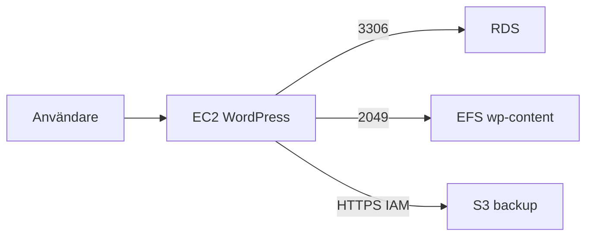

# AWS – Vecka 45 | Novatrix

WordPress, RDS, EFS och S3 i eu-north-1 (Stockholm).

## 1. Repo

**Uppgift:** Skapa avsnitt för v45 och uppdatera README.

Jag har förberett dokumentationen för vecka 45 i en separat README.md. Filen kan läggas i v45/ i det befintliga GitHub-repot. Publicering är inte verifierad.

## 2. Databas

**Uppgift:** Provisionera en hanterad RDS-databas i privat subnät.

Jag använder RDS-instansen novatrix-db med databasen wordpress. Webbservern når databasen via dess DNS-namn och en privat IP-adress. Exporten med mysqldump lyckades. Privat IP är verifierad; exakt subnätskonfiguration och Public access behöver kontrolleras i RDS.

## 3. Delad lagring

**Uppgift:** Sätt upp EFS för WordPress-filerna.

Jag skapade novatrix-efs i Stockholm. Filsystemet är Available, krypterat och har automatiska säkerhetskopior aktiverade. Jag monterade delad lagring på /var/www/html/wp-content och kontrollerade med df -h efter mount -a.

## 4. Objektlagring

**Uppgift:** Skapa S3-bucket, databasbackup, livscykelregel på 14 dagar och automatisk RDS-backup.

Jag skapade novatrix-backup och en aktiv livscykelregel backup-14 dagar för prefixet backup/. Aktuella objekt löper ut efter 14 dagar. Jag exporterade WordPress-databasen och laddade upp backup/wordpress-backup.sql. Filen verifierades i S3: 954 916 byte (932,5 KB). RDS-retention ska vara 1 dag enligt uppgiften; inställningen är inte verifierad i underlaget. I drift skulle jag välja 14 dagar för RDS-backup för att kunna återställa efter fel som upptäcks sent, med hänsyn till kostnad och verksamhetskrav.

## 5. Koppla ihop WordPress

**Uppgift:** Installera och konfigurera WordPress mot databas och delad lagring.

Jag konfigurerade WordPress på novatrix-web (EC2, Amazon Linux 2023). WordPress använder databasen wordpress på RDS och wp-content på den monterade lagringen. Webbsidan och WordPress-redigeraren visas i webbläsaren.

## 6. Säkra åtkomsten

**Uppgift:** Använd security groups mellan komponenterna utan onödig exponering.

Databasens security group novatrix-db-sg har en inkommande MySQL/Aurora-regel på TCP 3306 med en annan security group som källa, inte en publik CIDR. IAM-rollen novatrix-ec2-read fick s3:PutObject för arn:aws:s3:::novatrix-backup/backup/*. Policyn ger inte DeleteObject. EFS bör endast tillåta NFS TCP 2049 från webbserverns grupp; samtliga nätverksregler är inte verifierade här.

## 7. Verifiera och dokumentera

**Uppgift:** Visa att WordPress fungerar mot databas och delad lagring. Dokumentera arkitekturen.

Webbsidan visas, df -h visar monterad wp-content och databasexporten lyckades. S3-listningen och objektvyn bekräftar backupen. Arkitektur: användare → EC2 (WordPress) → RDS (TCP 3306); EC2 → EFS (NFS 2049); EC2 → S3 (HTTPS, IAM-roll). Ett separat återställningstest och fullständigt test av alla säkerhetsregler är inte dokumenterade.

## Arkitektur

## Dokumentation

[PDF med skärmbilder](AWS_V45_Novatrix.pdf)

Publicera inte lösenord, databasdump eller känsliga skärmbilder i ett publikt repo.
